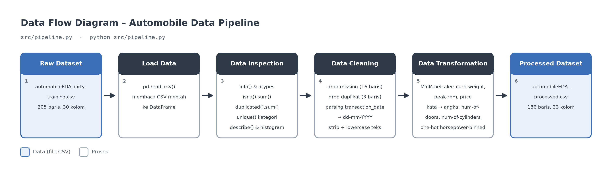

# Assignment Data Pipeline & Preparation – Muhammad Ilham (AI15)

**Dataset:** Automobile EDA

Pipeline ETL (Extract, Transform, Load) sederhana menggunakan Python dan pandas untuk memeriksa, membersihkan, dan mentransformasi dataset mobil `automobileEDA` hingga siap dipakai untuk analisis atau pemodelan machine learning.

## 1. Deskripsi Singkat Dataset

Dataset berisi spesifikasi teknis dan harga mobil dari berbagai merek (alfa-romero, audi, bmw, toyota, volvo, dan lainnya). Setiap baris adalah satu mobil, dengan kolom-kolom berikut:

| Kelompok | Kolom |
|---|---|
| Transaksi | `transaction_date` |
| Identitas | `make`, `body-style`, `aspiration`, `num-of-doors`, `drive-wheels`, `engine-location` |
| Dimensi | `wheel-base`, `length`, `width`, `height`, `curb-weight` |
| Mesin | `engine-type`, `num-of-cylinders`, `engine-size`, `fuel-system`, `bore`, `stroke`, `compression-ratio`, `horsepower`, `peak-rpm`, `horsepower-binned` |
| Konsumsi BBM | `city-mpg`, `highway-mpg`, `city-L/100km`, `diesel`, `gas` |
| Risiko & harga | `symboling`, `normalized-losses`, `price` |

## 2. Sumber Dataset

- File: `automobileEDA_dirty_training.csv`, yaitu dataset dalam folder data/raw

## 3. Struktur Folder Project

```
data-pipeline-assignment/
├── data/
│   ├── raw/
│   │   └── automobileEDA_dirty_training.csv   # dataset mentah (input)
│   └── processed/
│       └── automobileEDA_processed.csv        # dataset hasil pipeline (output)
├── documentation/
│   └── data-flow-diagram.png                  # diagram alur data ETL
├── src/
│   ├── data-pipeline.ipynb                    # notebook eksplorasi step-by-step
│   └── pipeline.py                            # script pipeline ETL
├── requirements.txt                           # daftar dependency
└── README.md
```

## 4. Temuan Awal Dataset (Kondisi Awal)

Hasil pemeriksaan dari function `inspect_data()`, yang ditampilkan di terminal saat `pipeline.py` dijalankan:

**Ukuran awal dataset:** 205 baris × 30 kolom (11 kolom teks, 11 float, 8 integer).

**Kolom yang memiliki missing values** (total 17 sel kosong):

| Kolom | Jumlah missing |
|---|---|
| `stroke` | 4 |
| `horsepower` | 3 |
| `price` | 3 |
| `transaction_date` | 2 |
| `make` | 2 |
| `num-of-doors` | 2 |
| `horsepower-binned` | 1 |

**Jumlah baris terduplikasi:** 4 baris. Baris 201–204 adalah salinan persis dari baris 5, 25, 60, dan 100.

**Kolom dengan tipe data yang belum sesuai:**

| Kolom | Tipe awal | Seharusnya | Contoh nilai |
|---|---|---|---|
| `transaction_date` | string | datetime | `2025-01-01` |
| `num-of-doors` | string | integer | `two`, `four` |
| `num-of-cylinders` | string | integer | `four`, `six`, `twelve` |

**Penulisan kategori yang belum konsisten:**

| Kolom | Variasi penulisan |
|---|---|
| `make` | `ALFA-ROMERO`, `Audi`, `BMW`, serta spasi berlebih seperti `dodge  `, `mercury  `, `porsche  ` |
| `body-style` | `SEDAN`, `Sedan`, `sedan` |
| `drive-wheels` | `RWD` / `rwd`, serta `AWD` yang bermakna sama dengan `4wd` |
| `fuel-system` | `MPFI`, `Mpfi`, `mpfi` |
| `horsepower-binned` | huruf kapital (`Low`, `Medium`, `High`), berbeda dari kolom kategorikal lain yang huruf kecil |

**Permasalahan lain:**
- `transaction_date` ditulis dalam **4 format berbeda**: `2025-01-01`, `02/01/2025`, `01-03-2025`, `04-Jan-2025`.
- Skala kolom numerik berbeda jauh, misalnya `curb-weight` 1488–4066, `peak-rpm` 4150–6600, dan `price` 5118–45400.
- Kolom kategorikal `horsepower-binned` belum dalam bentuk numerik.
- Tidak ditemukan nilai tidak wajar (nol atau negatif) pada kolom ukuran fisik, performa, maupun harga. Nilai negatif pada `symboling` (−2 s.d. 3) masih dianggap wajar.

## 5. Data Cleaning

Diimplementasikan di function `clean_data()`. Urutan langkah dan alasannya:

| No | Permasalahan | Kolom | Metode cleaning | Alasan |
|---|---|---|---|---|
| 1 | Data duplikat | semua kolom | `drop_duplicates(keep='first')` | Duplikat membuat satu observasi terhitung lebih dari sekali. Baris pertama (original) tetap disimpan. Langkah ini dilakukan sebelum menangani missing value agar jumlah duplikat terhitung akurat. |
| 2 | Missing values | `stroke`, `horsepower`, `price`, `transaction_date`, `make`, `num-of-doors`, `horsepower-binned` | `dropna()` (hapus baris) | Hanya 15 baris (±7%) yang terdampak, sehingga menghapusnya tidak banyak mengurangi data. Cara ini juga lebih aman daripada mengisi nilai tebakan: `price` adalah kolom target, `make` dan `transaction_date` tidak bisa ditebak secara wajar, dan imputasi (mean/median) bisa memasukkan bias. |
| 3 | Kapitalisasi dan spasi tidak konsisten | semua kolom kategorikal (`make`, `body-style`, `drive-wheels`, `fuel-system`, `horsepower-binned`, dll.) | `str.strip()` + `str.lower()` | Agar kategori yang sama (`BMW` / `bmw`, `porsche  ` / `porsche`) tidak terhitung sebagai kategori berbeda. |
| 4 | Label sinonim | `drive-wheels` | ganti `awd` → `4wd` | `AWD` hanya muncul 1 kali dan bermakna sama dengan `4wd`, label resmi pada dataset UCI. |
| 5 | Format tanggal tidak seragam dan bertipe string | `transaction_date` | `pd.to_datetime` dengan 4 format (`%Y-%m-%d`, `%d/%m/%Y`, `%m-%d-%Y`, `%d-%b-%Y`), dicoba bergantian | Agar tanggal bertipe datetime dan bisa diurutkan atau dianalisis. Format berikutnya hanya mengisi nilai yang belum berhasil di-parse, dan seluruh tanggal berhasil di-parse. Di file output, tanggal disimpan dengan format `dd-mm-yyyy`. |
| 6 | Angka ditulis sebagai kata | `num-of-doors`, `num-of-cylinders` | mapping `two` → 2, `four` → 4, ..., `twelve` → 12, lalu `astype(int)` | Agar bisa diolah sebagai angka. Jika ditemukan kata yang tidak ada di mapping, script akan berhenti dengan error, bukan diam-diam menghasilkan nilai kosong. |
| 7 | Pengecekan nilai tidak wajar | kolom ukuran fisik, performa, harga | cek nilai `<= 0` | Tidak ditemukan nilai tidak wajar, sehingga tidak ada data yang diubah. |

**Contoh hasil cleaning:**

| Kolom | Sebelum | Sesudah |
|---|---|---|
| `make` | `ALFA-ROMERO`, `dodge  `, `Audi` | `alfa-romero`, `dodge`, `audi` |
| `body-style` | `SEDAN`, `Sedan` | `sedan` |
| `drive-wheels` | `AWD`, `RWD` | `4wd`, `rwd` |
| `fuel-system` | `MPFI`, `Mpfi` | `mpfi` |
| `transaction_date` | `02/01/2025`, `01-03-2025`, `04-Jan-2025` | `02-01-2025`, `03-01-2025`, `04-01-2025` |
| `num-of-doors` | `two`, `four` | `2`, `4` |
| `num-of-cylinders` | `four`, `eight` | `4`, `8` |
| `horsepower-binned` | `Medium` | `medium` |

**Jumlah data sebelum dan sesudah cleaning:**

| Tahap | Jumlah baris | Missing values |
|---|---|---|
| Raw dataset | 205 | 17 |
| Setelah drop duplikat | 201 (−4) | 17 |
| Setelah drop missing value | **186** (−15) | **0** |

## 6. Data Transformation

Diimplementasikan di function `transform_data()`.

| Kolom | Metode | Alasan pemilihan kolom | Kolom baru / perubahan |
|---|---|---|---|
| `curb-weight`, `peak-rpm`, `price` | **Min-Max Scaling** (`sklearn.preprocessing.MinMaxScaler`) ke rentang 0–1 | Ketiganya punya rentang nilai ribuan dengan skala yang sangat berbeda satu sama lain, sehingga perlu disetarakan agar tidak mendominasi fitur lain. Kolom `length` dan `width` tidak di-scaling karena di raw dataset sudah berada di rentang 0–1. | Kolom baru `curb-weight_scaled`, `peak-rpm_scaled`, `price_scaled`. Kolom asli tetap ada agar nilai sebelum dan sesudah bisa dibandingkan. |
| `horsepower-binned` | **One-hot encoding** (`pd.get_dummies`) | Kolom kategorikal nominal dengan 3 kategori (`low`, `medium`, `high`), sehingga perlu diubah ke numerik agar bisa dipakai model. | Kolom baru `horsepower_high`, `horsepower_low`, `horsepower_medium` (nilai 0/1, sama seperti kolom `diesel`/`gas`). Kolom asli tetap ada. |

Sebagai transformasi tambahan, pembersihan teks sederhana (strip + lowercase) sudah dilakukan pada tahap cleaning (lihat bagian 5).

**Contoh Min-Max Scaling:**

| curb-weight | curb-weight_scaled | peak-rpm | peak-rpm_scaled | price | price_scaled |
|---|---|---|---|---|---|
| 2548 | 0.4112 | 5000 | 0.3469 | 13495 | 0.2080 |
| 2823 | 0.5178 | 5000 | 0.3469 | 16500 | 0.2826 |
| 2337 | 0.3293 | 5500 | 0.5510 | 13950 | 0.2193 |

Rumus yang digunakan: `x_scaled = (x − min) / (max − min)`.

**Contoh One-Hot Encoding:**

| horsepower-binned | horsepower_high | horsepower_low | horsepower_medium |
|---|---|---|---|
| low | 0 | 1 | 0 |
| medium | 0 | 0 | 1 |
| high | 1 | 0 | 0 |

**Jumlah data sebelum dan sesudah diproses:**

| | Jumlah baris | Jumlah kolom |
|---|---|---|
| Raw dataset | 205 | 30 |
| Processed dataset | **186** | **36** (+3 kolom scaling, +3 kolom one-hot) |

## 7. Cara Menginstal Dependency

Disarankan menggunakan virtual environment (Python 3.11+):

```bash
# buat & aktifkan virtual environment
python -m venv venv
venv\Scripts\activate        # Windows
# source venv/bin/activate   # macOS / Linux

# install dependency
pip install -r requirements.txt
```

Isi `requirements.txt`: `pandas`, `numpy`, `scikit-learn`, `matplotlib`, `jupyter`.

## 8. Cara Menjalankan `pipeline.py`

Jalankan dari **root folder project**:

```bash
python src/pipeline.py
```

Secara default, script membaca `data/raw/automobileEDA_dirty_training.csv` dan menyimpan hasilnya ke `data/processed/automobileEDA_processed.csv`.

Path input dan output dapat diganti dengan argumen:

```bash
python src/pipeline.py --input data/raw/file_lain.csv --output data/processed/hasil_lain.csv
```

Output di terminal dibagi menjadi beberapa bagian:
1. **PEMERIKSAAN AWAL DATASET**: 5 baris pertama, jumlah baris/kolom, nama kolom, tipe data, missing values per kolom, jumlah duplikat, nilai unik kolom kategorikal, dan statistik numerik.
2. **DATA CLEANING** dan **RINGKASAN CLEANING**: jumlah data dan missing values sebelum/sesudah cleaning, jumlah duplikat yang dihapus, dan kolom yang berubah.
3. **DATA TRANSFORMATION** dan **PERBANDINGAN SEBELUM & SESUDAH TRANSFORMASI**.
4. **SIMPAN HASIL**: lokasi file dan ukuran processed dataset.

Untuk melihat proses eksplorasi secara bertahap, buka notebook:

```bash
jupyter notebook src/data-pipeline.ipynb
```

## 9. Penjelasan Singkat Alur ETL



Seluruh proses dirangkai dalam function `run_pipeline()` di [src/pipeline.py](src/pipeline.py) dan berjalan dari awal sampai akhir dalam satu kali eksekusi:

| Tahap ETL | Function | Isi |
|---|---|---|
| **Extract** | `load_data()` | Membaca raw dataset CSV dari `data/raw/`. |
| | `inspect_data()` | Memeriksa dan menampilkan kondisi awal dataset. |
| **Transform** | `clean_data()` | Drop duplikat, drop missing value, standarisasi kategori, parsing tanggal, konversi kata ke angka, dan cek nilai tidak wajar. |
| | `transform_data()` | Min-max scaling dan one-hot encoding. |
| **Load** | `save_data()` | Menyimpan hasil akhir ke file CSV di `data/processed/`. |

## 10. Lokasi Processed Dataset

```
data/processed/automobileEDA_processed.csv
```

Berisi **186 baris × 36 kolom** dan siap digunakan untuk analisis lanjutan atau pemodelan.
